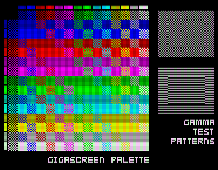
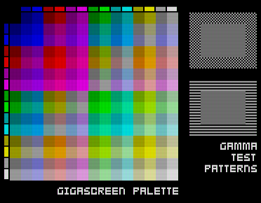
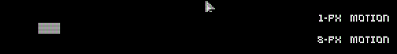
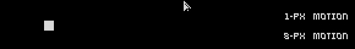
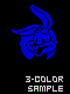
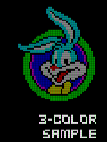

# Anti-flicker

```{index} Anti-flicker; how it works, GigaScreen, 3-color, flicker
```

Some Spectrum programs flicker on purpose, and on a modern screen that flicker shows as it
never did on a television. **Anti-flicker** mixes the frames back into the picture they were
meant to make. This page says what the flicker is, how the mixing decides what to mix, and
where it is better left off. The settings are in the
[Anti-flicker group](options-video.md#anti-flicker) of the **Video** page.

## Why Spectrum pictures flicker

The Spectrum has 15 colors, and only two of them in each 8 by 8 cell. Programs get past that
by showing a different picture in every frame:

- **GigaScreen** - two pictures in turn. A pixel black in one and red in the other is seen
  as dark red; a cell can show far more than two colors.
- **3-color** pictures - three pictures in turn, one red, one green and one blue. Every pixel
  gets its own color, each part of it shown every third frame.
- **Games** - more sprites than there is time to draw, drawn every other frame; a sprite
  that blinks to look see-through.

A television at 50 Hz blended the frames: its picture faded slowly, and the eye mixed the
rest. A modern screen shows each frame sharp and whole, so the pictures are seen one after
another, flickering - and on a 60 Hz screen they do not even take turns evenly.

## Mixing frames

```{index} Anti-flicker; Gamma, Anti-flicker; Intensity
```

Anti-flicker shows each pixel as a mix of its color in this frame and in the frames before.
**Intensity** is how much of the earlier frames goes in: at 100% two frames are mixed half and
half.

The colors are mixed as light, not as numbers. A screen's numbers are not in proportion to
the light it gives: a pixel at half the number is much darker than half as bright. So each
color is turned into light first, mixed, and turned back, the way a television's tube mixed
light. **Gamma** says how numbers turn into light; 2.2 is right for most screens. Mixed as
plain numbers, flickering colors come out too dark.

The GigaScreen palette of the [ZX EMU Flickering Test](https://github.com/dotkoval/flickering_test),
one frame as it is and with anti-flicker at 100%. In the gamma test on the right, the inner
rectangle matches its frame when **Gamma** suits the screen:

| One frame | Anti-flicker |
|---|---|
|  |  |

The two "fullscreen" modes mix every pixel that changed, all over the picture. A still
picture comes out right; anything that moves leaves a half-bright trail, as each frame is
mixed with where the thing was a frame ago. Below, a block moving 8 pixels a frame:
**2-frames (fullscreen)** turns it into a gray smear twice as wide, the adaptive modes leave it
as it is.

| 2-frames (fullscreen) | 2-/3-frames (adaptive) |
|---|---|
|  |  |

## The adaptive modes

```{index} Anti-flicker; adaptive, Anti-flicker; Look ahead
```

The adaptive modes mix only what flickers on purpose. A pixel that goes A, B, A, B... does;
a pixel of a moving picture can also go A, B, A by chance, but not for long. So a pixel is
mixed only once its two colors have taken turns for about six frames. Plain motion stays
sharp, a 1-pixel scroll at 50 frames a second included.

When a GigaScreen picture scrolls, both of its pictures move, and no pixel takes turns in its
place any more. So the picture is cut into bands of 16 rows, and for each band the program
finds how far it moved in two frames - from one picture to the same picture again. The frame
is then mixed with the frame before it moved half that far, which is the other picture where
it now stands. Some bands are left alone:

- a band whose half move would be an odd number of rows: a picture made of alternate lines
  would be mixed with its own other lines;
- a band that stood still between two of the three frames: it scrolls slower than the frame
  rate, and pairing it along its move would mix every pixel with its neighbor.

**2-/3-frames (adaptive)** also looks for 3-color pictures: pixels that are pure red, green or
blue and have repeated every third frame for a few frames. Those are mixed three frames at a
time; anything else is treated as two-frame flicker or left alone.

| One frame | Anti-flicker |
|---|---|
|  |  |

**Look ahead** shortens the start. A flicker that has just begun needs its six frames to be
seen; with look ahead, the next two frames are run in the background, the way
[Run ahead](input-lag.md#run-ahead) runs them, and the pattern is seen from both sides of
the frame shown. The picture is not held back for it, so it adds no input lag. It is not
used on the ZX Spectrum Next, where running frames twice costs too much.

The history starts again after a gap - Fast Mode, a rewind, anti-flicker turned off - or a
change of the picture's size; the first frame after it is shown as it is.

## When to leave it off

Anti-flicker is a guess about what a picture was meant to be, and some programs are better
without it:

- fast scrollers and single-pixel motion, in the fullscreen modes: they turn soft and leave
  trails; the adaptive modes leave most of them sharp;
- games that flicker to show more sprites: mixed, the sprites become half-bright and
  see-through, which is not how they looked on a television either;
- sharp color changes on a scrolling GigaScreen picture can still leave a comb pattern at
  their edges, and an object drawn on both pictures that moves can show twice.

The **Anti-flicker** action switches the intensity between 50%, 100% and off with one key, so
it can be turned off for the part of a program that needs it.

## Where it comes from

Work on anti-flicker began with the author's own GigaScreen game,
[Project AZX](https://spectrumcomputing.co.uk/forums/viewtopic.php?t=13101), as pull requests
to the original Xpeccy before Xpeccy+ began; it was then refined here and also released as a
[render plugin for Spectaculator](https://github.com/dotkoval/spectaculator-gigascreen-noflick).
Its aims are colors close to a CRT's and as few wrong mixes as can be had in the special cases;
it is not perfect. Similar work goes on in other projects.
