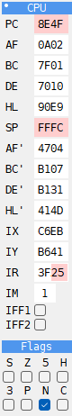
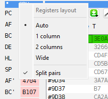
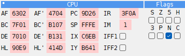

# CPU panel

```{index} CPU panel, register, flag
```



The **CPU** panel shows the Z80 registers: PC, AF, BC, DE, HL, SP, the alternate set AF',
BC', DE', HL', then IX, IY, IR, IM and the interrupt switches IFF1 and IFF2. Under them
are the flags S, Z, 5, H, 3, P, N and C.

A register that changed in the last step is marked in the **Changed** color of the
**Debugger** page of **Options**. With **Split pairs** on, only the byte that changed is
marked: after an instruction that changes only A, only the A half of AF lights up.

The values are hex or decimal, as the Debugger's other numbers (see
[Hex or decimal](debugger-code.md#hex-or-decimal)). In decimal a pair is two numbers with
**Split pairs** on, a byte each in a field of its own, as `  1 | 255` for HL = 511, and each
lights up on its own; with **Split pairs** off it is one number, `  511`. PC and SP are as
wide as a pair, and IM as one byte of it; every number stands at the right of its field.

Rest the mouse on **IM**, **IFF1** or **IFF2** for what it is. The tip of **IM** also says
where an INT goes now, as the tip of **INT** in the side panel does (see
[MEMMAP panel](debugger-memmap.md)).

## Changing registers

```{index} register; changing
```

Click a value and type over it, in hex or in decimal as it is shown. The change takes
effect at once. In a value field:

- Up and Down, or the mouse wheel, add or subtract 1;
- PgUp and PgDn add or subtract 256;
- X switches the field between hex and decimal.

IFF1 and IFF2 are check boxes. Tick or untick a flag to change it in F.

Click the name of a register to see, in the listing, the code at the address the register
holds.
Right-click the name to see that address in the **DUMP** panel.

**IM** and **IR** are no addresses, so they point at where an INT goes instead:

- click **IM** or **IR** - the listing shows the interrupt handler: in IM 1 `#0038`, in
  IM 2 (and for **IR** always) the address from the table at I * 256;
- right-click **IM** - **DUMP** shows the word of the table the CPU reads in IM 2, the
  handler in IM 0 and IM 1;
- right-click **IR** - **DUMP** shows the table itself, from I * 256.

## Layouts

```{index} CPU panel; layout, Split pairs
```

Right-click the panel's title bar to choose how the registers are laid out. A small dot in
the corner of a title bar shows that the panel has such a menu.



- **Auto** (the default) - one column when the panel is narrow, two when it is wide enough.
  **Auto** also uses two columns when two panels stand side by side under the **CPU**
  panel.
- **1 column** - a register on each line.
- **2 columns** - two on a line, each beside its pair: AF beside AF', PC beside SP.
- **Wide** - a column for each kind: AF, BC, DE, HL; the alternate set; PC, SP, IX, IY; and
  IR, IM, IFF1, IFF2. The flags are one more column beside them, under the title **Flags**.
- **Split pairs** - mark only the byte that changed, as above, and in decimal write a pair
  as two numbers. On by default.


