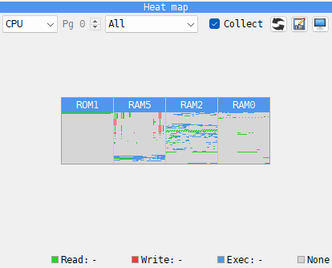
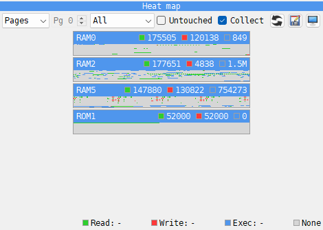
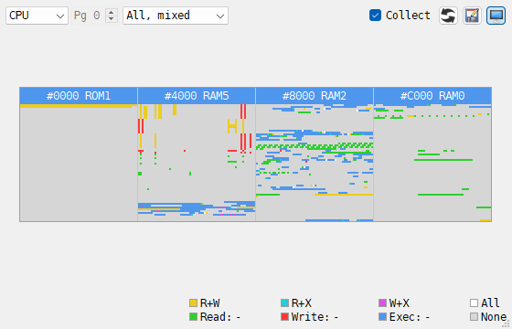

# Heat map panel

```{index} Heat map, Heat map; CSV export, Collect
```



1. What the picture covers - **CPU**, **Pages**, or one memory area such as **RAM** or
   **ROM** - and the page for an area.
2. The counter shown, and how - **All**, **All, mixed**, **All, by count**, **Read**,
   **Write** or **Exec**.
3. **Collect**, and the buttons that {icon}`refresh` reset the counters, {icon}`save-as`
   export them and {icon}`display` show the panel in its own window.
4. The picture.
5. The address under the mouse, and the legend with its counts.

The **Heat map** counts, for every byte of memory, how many times the program has read it,
written it and run it: RAM and ROM, and the EEPROM and RAM of a divMMC when the machine has
one. Click the **Heat map** tab, under the **DUMP**, and tick **Collect**: counting starts
and goes on while the machine runs, also with the Debugger closed, until you untick it.
With **Collect** off the picture says **collecting is off**.

## Colors

```{index} Heat map; colors, All, mixed, All, by count
```

Each counter has its color: **Read** green, **Write** red, **Exec** blue. A byte nothing
has touched is gray. **Read**, **Write** and **Exec** show one counter alone. **All** shows
the three at once, in one of three ways:

- **All** - each cell takes the color of the counter that wins: blue when it was run more
  often than read and written together, else red when written more than read, else green.
- **All, mixed** - each counter that is not 0 adds its color: read and write together make
  yellow, read and exec cyan, write and exec magenta, all three white. The line above the
  legend shows the mixes.
- **All, by count** - red, green and blue are write, read and exec, each as bright as its
  count: dim for a single access, full for the biggest count of that counter in the
  picture. The line above the legend shows each scale with its biggest count.

**Exec** counts every byte the CPU reads as part of an instruction, operands included, and
the byte after a HALT, which the CPU fetches over and over while it waits; **Read** counts
only the data it reads. So the picture reads like a map of the program:
blue is code, red is what it changes - the screen, the variables, the stack - and green is
what it only reads, such as graphics, fonts and tables.

## CPU

**CPU** shows the 64K the CPU sees now as four squares, one for each 16K window, with one
cell for 4 bytes. Each heading says where the window starts and what memory is in it:
**#4000 RAM5**. When the two halves of a window hold different memory - a divMMC's EEPROM
and one of its RAM banks over the ROM - a line parts them and the heading names both:
**DIVROM / DIV3**. The ZX Spectrum Next pages its memory by 8K, so there the picture has
eight narrower slots, one for each 8K.

## One page

**RAM**, **ROM** and the other areas show one page of that memory, with one cell for each
byte, and scroll when the panel is too small. The list holds the areas the machine has:
**DIVROM** and **DIV** with a divMMC, and on the ZX Spectrum Next also **ALTROM**,
**MFROM** and **MFRAM**. The page box counts pages as the machine does: 16K, but 8K for
the Next's RAM and for the divMMC's RAM.

## Pages

```{index} Heat map; Pages, Untouched
```



**Pages** lists the pages the program has touched, one strip each: the page's name, its
cells (one for 4 bytes), and its read, write and exec counts. Tick **Untouched**, beside
**Collect**, to list every page. Click a strip to open that page. On a machine with megabytes of memory - 4 MB
on a ZX Evolution, 2 MB on the Next - this shows at once where the program lives.

## The readout

Hold the mouse over a cell to see its address, the page it is in and the offset in that
page - **#4000-#4003  RAM5 #0000** - and its counts: **Read:**, **Write:**, **Exec:**. The
addresses here and in the headings are written as the Debugger's are: see
[Hex or decimal](debugger-code.md#hex-or-decimal). Over
the heading of a strip, the counts are the page's. A byte's count stops at 4294967295 and
then reads **max**; a page's counts go on. In the Debugger, double-click a cell and
the listing goes there, if the CPU can see that memory now.

## Heat Map window

```{index} Heat Map window
```



**Tools > Heat Map**, or the {icon}`display` **Show in its own window** button, moves the
panel out of the Debugger into a window of its own, **Heat Map**. The same command, the
button again, or closing the window puts the panel back; while it is out, its tab in the
Debugger says so, with a **Bring it back** button.

The window works without the Debugger: the picture follows the machine while it runs, once
a frame, or less often when a big picture takes long to draw (in fast mode, once in ten
frames). The window keeps its place and size, and a window that was open when you quit
opens again at the next start. It has no key by default; one can be set in
[Hotkeys](hotkeys.md).

## Reset and export

The {icon}`refresh` button with the circular arrows resets all counters, after asking.
Loading a snapshot resets them too. The {icon}`save-as` button beside it saves all counters
to a CSV file, with the columns `type,page,offset,read,write,exec` and one line for each
byte, untouched bytes included, for a spreadsheet or a script of your own. `type` is the
memory - `RAM`, `ROM`, and `ALTROM`, `DIVROM`, `DIV`, `MFROM`, `MFRAM` where the machine
has them - and `page` counts pages as the page box does.
