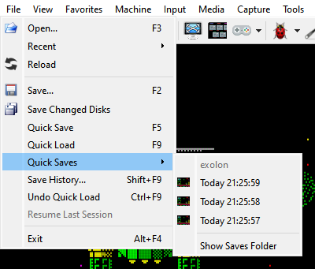
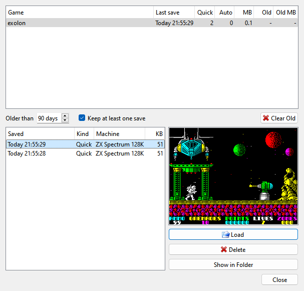

# File menu

```{index} File menu
```

Xpeccy+ opens snapshots, tapes, disks, cartridges and RZX recordings, and saves snapshots,
tapes and disks. The **File** menu opens and saves them and keeps the quick saves. Tapes
and disks have pages of their own under the **Media** menu:
[Tapes](tapes.md) and [Floppy disks](disks.md). Which machine a file runs on is set on the
[File types page](options-file-types.md).

## File formats

```{index} file format, TAP, TZX, WAV, TRD, SCL, UDI, DSK, TD0, FDI, IMA, IMG, Hobeta, cartridge; file
```

| Kind | Files | Open | Save |
|---|---|---|---|
| Snapshot | `.szx` | yes | yes, every machine but the ZX Spectrum Next |
| | `.z80` | yes | 48K, 128K, +2, +2A, +3, Pentagon, Scorpion |
| | `.sna` | yes | yes, every machine but the ZX Spectrum Next |
| | `.spg` (ZX Evolution TSConf) | yes | no |
| | `.nex`, `.snx` (ZX Spectrum Next) | yes | no |
| Tape | `.tap` | yes | yes |
| | `.tzx` | yes | no |
| | `.wav` | yes | yes |
| Disk | `.trd`, `.scl`, `.udi`, `.dsk` | yes | yes |
| | `.td0`, `.fdi`, `.ima`, `.img` | yes | no |
| TR-DOS file | Hobeta (`.$B`, `.$C` and so on) | yes, onto a disk | no |
| Any file | **RAW file to disk** | yes, onto disk A | no |
| Cartridge | `.rom`, `.bin` | yes | no |
| Recording | `.rzx` | yes | from the **Capture** menu |
| Cheats | `.pok` | yes, into the [Cheats](cheats.md) window | no |
| Archive | `.zip`, `.gz`, `.7z` | yes, an image in it: see [Images in archives](#images-in-archives) | no |

A Hobeta file opens as a TR-DOS file on a disk: in drive A, or in the drive picked from the
file types of the open dialog. A drive with no disk gets a new, formatted one first.

```{index} RAW file to disk
```

**RAW file to disk** is a choice of file type in the open dialog. It writes any file onto
the disk in drive A as a TR-DOS file, in parts if the file is long.

Screenshots, video and sound files are in [Capture menu](capture.md).

## Opening a file

```{index} Open, Recent, Reload
```

**File > Open...** opens the program's file dialog. You can also drop a file onto the
window, pick one from **File > Recent** or from **Favorites**, or name it on the command
line. Whether a tape or a disk is run or only mounted is explained in
[Run a program](getting-started.md#run-a-program).

To choose Run or Mount for one file only, hold Shift as you drop it, or as you click
**Open** in the open dialog. A small menu asks: **Run** or **Mount**.

**File > Recent** lists the last 10 files opened, newest first. Hold the mouse over an item
to see where the file is. A file that no longer exists is reported and taken off the list.
A file of a type Xpeccy+ does not know is reported as **Unknown file type** and does not
go on the list.
**Clear** empties the list. A file whose game has saves opens a menu: **Open** opens it as
the item would, and under it are the game's saves, newest first, to load (see
[Quick saves](#quick-saves)).

**File > Reload** opens the last file again, the way it was opened: into the same drive,
run or mounted. If you loaded a labels file in the Debugger, it is read again too.

```{index} Auto-load labels, labels file
```

When **Auto-load labels** is ticked on the **Debugger** page of **Options**, opening a file
also loads a `.labels` file of the same name from the same folder, if there is one. A disk
opened into drive B, C or D does not load labels.

### Images in archives

```{index} archive, ZIP, 7z, gz, Open from Archive
```

A snapshot, tape or disk packed in a `.zip`, `.gz` or `.7z` archive opens as if it were not
packed: open the archive, drop it onto the window, pick it from **Recent** or name it on the
command line. No archiver is needed.

Only the images the open is for are offered: **Disk A** in the open dialog offers the disks
in the archive, the Tape Player's **Open** its tapes. Text files, pictures, cheats and the
`SCRSHOT`, `INFO` and `POKES` folders of an archive are left out.


An archive with one image opens it at once. With several, **Open from Archive** lists them
with their kind and size, the first one ready: Side A before Side B, Part 2 before Part 10.
The command line takes the first one without asking.

The window title, **Recent**, **Favorites** and **Reload** name the image with its archive,
as `game.zip > Side B.tzx`, and open that image again. While a disk or a tape from an
archive with several of its kind is in, the drive's menu and the tape menu list them under
**Open...**, the one that is in marked: pick another to put it in.

Nothing is written into an archive. A changed disk from one is saved as a file of its own:
the save dialog offers the image's name in the archive's folder. A `.labels` file is looked
for in that folder too, named after the image.

An encrypted archive, a ZIP64 one, one split into parts, or an image that unpacks to more
than 256 MB is not opened; a message says why.

### The file dialog

```{index} file dialog
```

All opening and saving goes through the program's own file dialog, the same on every
system. It starts in the folder you used last.

The list of file types at the bottom is more than a filter: the type you pick says what
the file is opened as. **Disk B** puts a disk into drive B, **RAW file to disk** writes any
file onto disk A, and with **All files** the file's extension decides.

## Saving

```{index} Save, snapshot; saving, tape; saving, disk; saving
```

**File > Save...** saves a snapshot, the tape or a disk. The file types in the dialog say
what is saved: **Snapshot**, **Tape** when a tape is in, and **Disk A** to **Disk D** for
each drive with a disk. Type the extension of the format you want; with no extension the
file gets `.szx`, `.tap` or `.trd`.

**WAV recording, export** writes the tape as sound (see
[Export to WAV](tapes.md#export-to-wav)). It is a copy, not the tape's own file, so the
tape still counts as changed after the export.

When a file cannot be saved, a message says why, for example a tape with blocks a `.tap`
cannot hold, or a disk that is not TR-DOS saved as `.trd`.

```{index} Save Changed Disks
```

**File > Save Changed Disks** saves every disk that was written to, each to its own file.
It asks about each disk first: **Yes**, **No** or **Cancel**. The same question is asked
for a changed disk or tape when you close the program, eject it or put another one in;
**Cancel** keeps the disk or tape where it is, and keeps the program open.

## Snapshots

```{index} snapshot, SZX
```

```{index} see: save state; snapshot
```

A snapshot is the whole machine at one moment. Opening one puts the machine back to that
moment, and it runs on from there.

**SZX** is the format to use. A `.szx` saved by Xpeccy+ keeps everything: memory, the
processor, the sound chips, the disk controller, the tape position, and the exact point in
the frame. It also records the machine it was taken on, and the file names of the tape and
the disks. The images themselves are not inside: save a changed disk too.

When an SZX is opened, its tape and disks go back in: from where they were, or from the
snapshot's own folder. The tape is wound to the block it was at. A disk that is already
in its drive is left as it is, so what was written to it since is not lost. Images that a
snapshot carries inside it are written to the system's temporary folder and put in from
there.

An SZX opens on exactly the model it names. If that model is not one of the built-in
machines, it opens on the nearest one. When the snapshot was taken with something the
machine does not have - other ULA timings, ULA+, an AY, a disk interface, a device that
is not emulated - a warning lists what is missing. The machine's settings are not changed
to match.

```{index} Z80, SNA
```

**Z80** and **SNA** are older formats that many programs read. They keep less:

- `.z80` can be saved only on a 48K, 128K, +2, +2A, +3, Pentagon or Scorpion. It keeps the
  first 128K of memory (256K on a Scorpion), but not whether TR-DOS is paged in.
- `.sna` has no place for the point in the frame. A running machine is saved at the next
  interrupt, which is where loading puts it back. If that cannot be done, the message
  **SNA: no frame position, use SZX** appears. It keeps 48K or 128K of memory.

A `.z80` or `.sna` opens on any machine that can run the model it was saved from: a 48K
snapshot runs anywhere, a 128K one on anything but a 48K, a +3 one on a +2A or +3.

```{index} SPG
```

**SPG** is a ZX Evolution (TSConf) format. Xpeccy+ can open it but not save it, and only on
that machine.

```{index} NEX, SNX
```

**NEX** programs and **SNX** snapshots need the ZX Spectrum Next. It starts them, and `.z80`
and `.sna` snapshots too, through NextZXOS, from its SD card: see
[Starting programs](zx-next.md#starting-programs). A snapshot of the Next cannot be saved yet.

## Quick saves

```{index} Quick Save, Quick Load, Undo Quick Load, Quick Saves, snapshot; quick save
```

**File > Quick Save** (F5) saves the machine as it is now into the folder of the game: the
image you opened last into drive A, as a tape or as a snapshot. A disk in drive B does not
count. Each game keeps the last 20 quick saves; a new one past that number deletes the
oldest. The game is known by its contents, so the same game opened from an archive, as a
plain file or from another folder shares its saves. When no game is open, or the game's tape
or disk has been taken out, the saves go to the folder of the machine instead.

**File > Quick Load** (F9) puts back the game's newest quick save, on the machine it was
taken on. **File > Quick Saves** lists the game's saves, newest first, with the time each
was taken; hold the mouse over one to see its picture, click it to load it.
**Show Saves Folder** opens the game's folder.



A save takes the tape and the TR-DOS disks with it. Loading it puts them back as they were
when it was taken: the tape at its place, and a disk with whatever the game had written to
it by then. So a save still loads after the image or its archive was moved or deleted. A
+3 disk is not carried: the save names it, and it has to stay where it was.

**File > Undo Quick Load** (Ctrl+F9) takes back the last quick load and returns to where you
were, the tape and the disks too. Use it again to redo the quick load.

A ZX Spectrum Next cannot be saved to a file yet: its quick save is kept in memory until
the program closes.

### Autosaves

```{index} autosave, Resume Last Session
```

When the program closes, it saves the machine. **File > Resume Last Session** puts that
back: the machine, the game and its media. To start where you left off every time, choose
**Resume last session** in **Machine at start** on the [Application page](options-application.md).

The autosave on exit goes into the game's folder when the game has one - that is, after its
first quick save - and the folder keeps the last few of them. Otherwise there is one autosave,
written over each time. The [Saves page](options-saves.md) of **Options** can also save
every few minutes of play, and sets how many saves of each kind a game keeps.

### Save History

```{index} Save History
```

**File > Save History...** (Shift+F9) lists every game with saves: the time of its last save,
how many quick saves and autosaves it has, and their size in MB. It opens on the game in use,
its newest save picked: Enter loads it.



**Clear Old** deletes the saves older than the number of days next to it, in every game. The
**Old** and **Old MB** columns show what it would delete. With **Keep at least one save** on,
each game keeps its newest save however old it is.

Click a game to see its saves below, with a picture of the selected one. **Load** loads it
(a double click does too), **Delete** deletes the selected saves, and **Show in Folder**
opens the game's folder. A game whose last save goes disappears from the list.

## RZX recordings

```{index} RZX, RZX Player
```

An `.rzx` file is a recording of a whole session, played back exactly. Opening one plays
it in the **RZX Player**, on exactly the machine it was recorded on. See
[Playing an RZX](capture.md#playing-an-rzx) and
[Recording an RZX](capture.md#recording-an-rzx).

## Exit

```{index} Exit
```

**File > Exit** closes the program (on macOS it is **Quit** in the application menu). Before
it closes, it asks about every changed disk and tape, and with **Confirm exit** on the
**Application** page of **Options** it asks first whether to close at all. **Options...** is
in the [Tools menu](tools.md).
