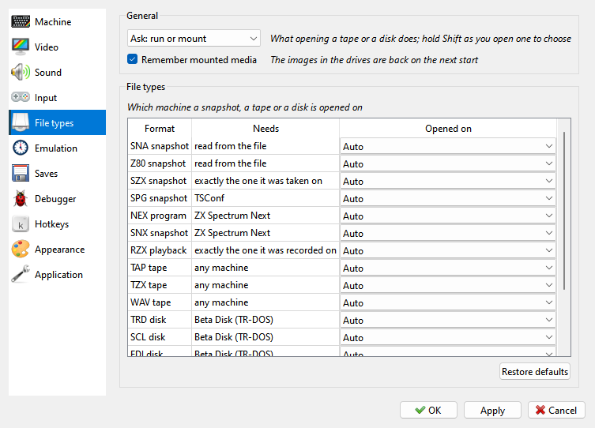

# File types page

```{index} File types page
```



What opening a tape or a disk does - run it, mount it, or ask - and whether the media in
the drives come back at the next start. The table says which machine each kind of file
opens on.

```{index} machine; switched by a file, Opened on, Run opened media, Mount opened media, Remember mounted media
```

What a file needs and which machine it switches to are explained in
[Run a program](getting-started.md#run-a-program). The **File types** page of **Options**
sets this for each format.

The **General** group at the top of the page:

- **Run opened media**, **Mount opened media** or **Ask: run or mount** - what opening a
  tape or a disk does. **Ask** shows the **Open Media** question; ticking
  **Remember my choice** there saves your answer in this setting.
- **Remember mounted media** - the tape and the disks in the drives are opened again at the
  next start.

The **File types** group has a row per format:

- **Format** - the kind of file.
- **Needs** - what a machine must have to run it: **any machine**, **Beta Disk (TR-DOS)**,
  **+3 disk drive**, **TSConf**, **ZX Spectrum Next**, **read from the file** (a `.z80` names its
  model, a `.sna` only 48K or 128K), **exactly the one it was taken on** (SZX) or **exactly the one it was recorded
  on** (RZX).
- **Opened on** - **Auto**, **Ask**, **Keep current**, or one machine from the list.

A tape runs on any machine, so its rows have no **Ask**: **Auto** in these rows only
switches back to your own machine after another file switched away from it. A machine
picked in **Opened on**
is used for every file of that format that it can run. **Restore defaults** sets every
row back to **Auto**.

Only a file that is about to run can switch the machine: a snapshot always, a tape or a disk
only when it is run, and a disk only from drive A.

```{index} snapshot; which machine runs it
```

A `.z80` or `.sna` snapshot runs on any machine with its memory paging. One taken inside
the ROM - in the 128K menu or the BASIC editor, or in the middle of a ROM routine - also
needs the very same ROM:

- A `.z80` taken in the 128K menu or editor opens on the model it names. Even the clones'
  ROMs differ there: the Pentagon's menu has a TR-DOS item the 128K's has not. One stopped
  in a 48 BASIC routine needs the same editor: a 128K one runs on the 128K and the clones,
  not on the +2, +2A or +3.
- A `.sna` names no model. For one taken in the 128K menu or editor, Xpeccy+ tells from
  the snapshot whether it was a 128K or a clone, a +2, a +2A or a +3. The menu on its
  screen tells a 128K from a Pentagon or a Scorpion. A snapshot that does not tell stays on
  the current machine if it is a 128K or a clone. To keep the model for sure, save as `.z80`
  or `.szx`.
- A program running in RAM stays on the current machine, unless it keeps the 128K
  editor's ROM paged in, which the +2, +2A and +3 do not have.

A machine of your own counts by its hardware, whatever ROM files it has.
