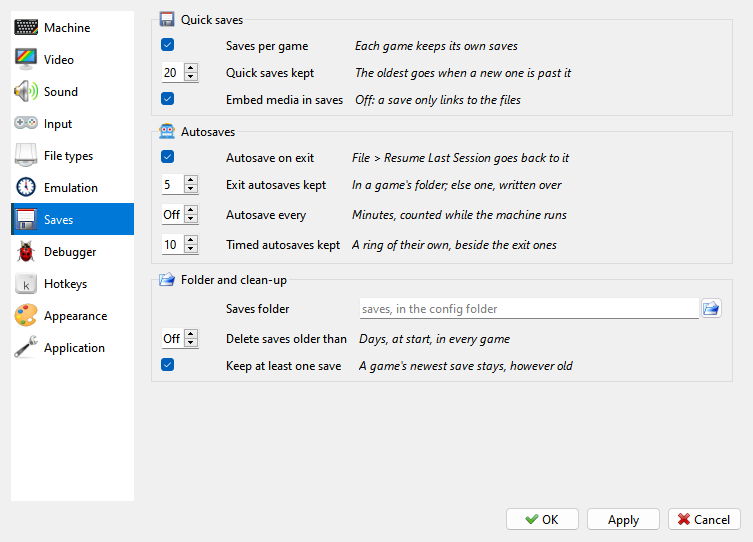

# Saves page

```{index} Saves page, quick save; settings, autosave; settings
```



The **Saves** page of **Options** sets where the [quick saves](files.md#quick-saves) and
autosaves go and how many of them stay.

**Quick saves**

- **Saves per game** - each game has a folder of its own. Off, every save of a machine goes
  into one folder, whatever runs on it.
- **Quick saves kept** - how many quick saves a game keeps; a new one past that deletes the
  oldest. 20 by default.
- **Embed media in saves** - a save carries the tape and the TR-DOS disks, as they were, and
  brings them back. Off, a save only links to the files: smaller, but they have to stay where
  they are.

**Autosaves**

- **Autosave on exit** - the machine is saved as the program closes, for
  **File > Resume Last Session**.
- **Exit autosaves kept** - how many a game with quick saves keeps. A game with none has
  one autosave, written over each time.
- **Autosave every** - a save every so many minutes. Only the time the machine runs counts:
  a pause, a menu or the Debugger holds it. **Off** by default.
- **Timed autosaves kept** - how many of those a game keeps, apart from the exit ones.

**Folder and clean-up**

- **Saves folder** - where the saves go; the button picks it. Empty: the `saves` folder in
  the [settings folder](getting-started.md#where-the-settings-are).
- **Delete saves older than** - at each start, saves older than so many days are deleted, in
  every game. **Off** by default; **File > Save History** does the same by hand.
- **Keep at least one save** - each game keeps its newest save, however old.
